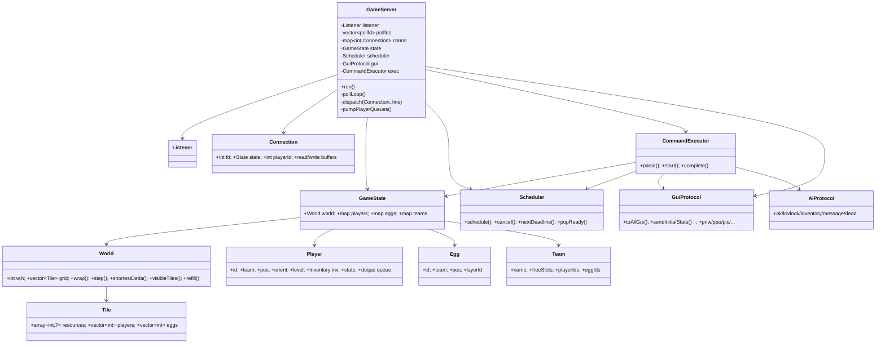

# SERVER_PLAN — Plan d'implémentation de `zappy_server`

> Projet **Zappy** (B-YEP-400, EPITECH). Cible : Linux (dev sous WSL2).
> Langage : **C++20**. Serveur **mono-processus, mono-thread**, multiplexage **`poll()`**, **aucune attente active**, I/O **non bloquantes bufferisées**.
> Référence fonctionnelle : [`data/PROJECT.md`](../data/PROJECT.md) + PDF dans [`data/subject/`](../data/subject/). Binaire de référence dispo : [`data/binaries/linux/zappy_server`](../data/binaries/linux/zappy_server) (à utiliser pour calibrer les comportements ambigus).

---

## 0. État des lieux & écarts à corriger

Le squelette réseau existe déjà et est de bonne qualité. À adapter avant d'attaquer le jeu :

| Constat | Action |
| --- | --- |
| `server/Makefile` est en **`-std=c++17`** | Passer en **`-std=c++20`** (contrainte imposée). |
| Dossier **`server/src/client/Client.{cpp,hpp}`** orphelin, doublon de `server/src/server/Client.*` (non compilé par le Makefile) | Supprimer `src/client/` pour lever l'ambiguïté. |
| Le sujet/PROJECT parle de `docs/` et `PROJECT.md` à la racine ; en réalité c'est `data/PROJECT.md` et `data/subject/*.pdf` | Pas de blocage : le plan vit dans `docs/SERVER_PLAN.md`. Voir Q1 (où ranger la doc). |
| Handshake actuel : envoie `slot->second` **après** décrément → la valeur `CLIENT-NUM` envoyée vaut `slots_restants_après_cette_connexion`. À revérifier vs serveur de référence | Voir §4.4 + zone de risque R7. |
| README binaire de réf : options bonus `--auto-start on\|off`, `--display-eggs true\|false`, `-v/--verbose`, commandes stdin (`/quit`, `/map`, …) | Hors périmètre obligatoire ; parser doit **tolérer/ignorer** les inconnues seulement si on vise le bonus. Pour l'instant : rester strict (notre parser rejette déjà l'inconnu). |
| Réf serveur utilise `select` ; le sujet **nous impose `poll`** | On garde `poll` (déjà en place). |

**Ce qui est déjà bon et à conserver** : hiérarchie `Error/ArgError/NetworkError`, `Parser` (validation propre, `from_chars`), sockets non bloquantes + `SO_REUSEADDR`, buffers `_readBuffer`/`_writeBuffer` dans `Client`, découpage de lignes (`extractLine`, gestion `\r`), `syncPollOut` (POLLOUT activé seulement si write en attente), suppression client sur `recv<=0` et `POLLHUP/ERR/NVAL`, itération `pollFds` à l'envers pour supprimer en cours de boucle.

---

## 1. Architecture générale (modules & dépendances)

Découpage en couches. **Règle de dépendance : le réseau ne connaît pas le jeu, le jeu ne connaît pas les sockets.** Les deux se rencontrent dans l'orchestrateur (`GameServer`).

```
                         main.cpp
                            │
                       ┌────▼────┐
                       │ Parser  │ (args → Config)        [existant]
                       └────┬────┘
                            │
                     ┌──────▼───────────────────────────────────────┐
                     │              GameServer (orchestrateur)        │
                     │  possède: Net, World, Scheduler, registries    │
                     │  boucle poll(): réseau + temps                 │
                     └───┬───────────────┬───────────────────┬───────┘
          ┌──────────────┘               │                   └───────────────┐
   ┌──────▼───────┐            ┌─────────▼─────────┐               ┌─────────▼─────────┐
   │  net/        │            │  game/            │               │  protocol/        │
   │  Listener    │            │  World (carte)    │               │  GuiProtocol      │
   │  Connection  │◄── buffers │  Tile, Resource   │               │  (formate+pousse  │
   │  (fd, I/O)   │            │  Player, Egg, Team│               │   msz/bct/pnw/...) │
   └──────────────┘            │  GameState        │               └─────────┬─────────┘
                               └─────────┬─────────┘                         │
                          ┌──────────────┴──────────────┐                    │
                  ┌───────▼────────┐            ┌────────▼────────┐   ┌──────▼───────┐
                  │ commands/      │            │ time/           │   │ AiProtocol   │
                  │ CommandParser  │            │ Scheduler       │   │ (réponses IA)│
                  │ CommandExec    │            │ Event (heap)    │   └──────────────┘
                  │ (12 commandes) │            │ Clock           │
                  └────────────────┘            └─────────────────┘
```

### Modules et responsabilités

| Module (dossier) | Classes | Responsabilité | Dépend de |
| --- | --- | --- | --- |
| `args/` | `Parser`, `Config` | Parsing/validation CLI. *(existant)* | `Error` |
| `net/` | `Listener`, `Connection` | Socket d'écoute, accept, lecture/écriture non bloquante bufferisée, découpage en lignes, détection déconnexion. (`Connection` = l'actuel `Client` renommé/élargi). | `Error` |
| `core/` | `GameServer` | Possède tout, tient la boucle `poll()`, route les lignes vers IA/GUI, relie `Connection` ↔ `Player`/GUI session. | tous |
| `game/` | `World`, `Tile`, `Player`, `Egg`, `Team`, `GameState` | Modèle de données + règles pures (déplacement torique, vision, incantation, respawn, food). **Aucun appel socket.** | `time/` |
| `commands/` | `CommandParser`, `CommandExecutor`, table de dispatch | Parse une ligne IA → commande typée ; applique l'effet sur `GameState` à l'échéance ; renvoie la réponse IA + déclenche les events GUI. | `game/`, `protocol/` |
| `time/` | `Clock`, `Scheduler`, `Event` | Horloge monotone, file de priorité d'événements datés, calcul du timeout `poll()`. | — |
| `protocol/` | `GuiProtocol`, `AiProtocol` | Sérialisation **exacte** des messages des 2 protocoles ; `GuiProtocol` connaît la liste des connexions GUI pour diffuser. | `game/`, `net/` |
| `Error.hpp` | `Error`, `ArgError`, `NetworkError`, (`GameError`?) | Exceptions. *(existant)* | — |

> **Principe directeur** : `game/` est **testable unitairement sans réseau ni temps réel** (on injecte un temps logique). C'est ce qui rend le projet vérifiable.

---

## 2. Modèle de données

### 2.1 Types de base

```
enum class Resource { Food=0, Linemate, Deraumere, Sibur, Mendiane, Phiras, Thystame };
constexpr int RESOURCE_COUNT = 7;
constexpr double DENSITY[RESOURCE_COUNT] = {0.5,0.3,0.15,0.1,0.1,0.08,0.05};

enum class Orientation { North=1, East=2, South=3, West=4 };  // valeurs = protocole GUI 'O'

using Inventory = std::array<int, RESOURCE_COUNT>;  // quantités indexées par Resource
struct Pos { int x; int y; };
```

### 2.2 `Tile`

| Attribut | Type | Rôle |
| --- | --- | --- |
| `resources` | `Inventory` (`array<int,7>`) | quantités au sol par ressource |
| `players` | `std::vector<int>` | ids des joueurs présents (accès O(1) pour Look/Incantation/Eject) |
| `eggs` | `std::vector<int>` | ids des œufs présents |

> Choix : stocker les **ids** (pas des pointeurs) pour éviter l'invalidation lors des `erase` dans les conteneurs. La position est dupliquée (Tile↔Player) ; un invariant unique « `Player.pos` ⇔ `World.tile(pos).players contient id` » est maintenu par les seules méthodes `World::placePlayer/movePlayer/removePlayer`.

### 2.3 `World` (carte torique)

| Attribut / méthode | Rôle |
| --- | --- |
| `int width, height` | dimensions |
| `std::vector<Tile> grid` | taille `width*height`, index `idx(x,y)=y*width+x` |
| `Tile& at(int x,int y)` | accès **après wrap** torique |
| `Pos wrap(int x,int y)` | `((x%w)+w)%w`, idem y (gère négatifs) |
| `Pos step(Pos, Orientation, int n=1)` | avance de n tuiles (Forward) |
| `Pos shortestDelta(Pos from, Pos to)` | vecteur torique le plus court (broadcast) — §9.2 |
| `void refill(Scheduler&, GuiProtocol&)` | respawn ressources jusqu'aux cibles — §5.3 |
| `std::vector<Pos> visibleTiles(Pos, Orientation, int level)` | tuiles vues, dans l'ordre Look — §9.1 |

### 2.4 `Player`

| Attribut | Type | Rôle |
| --- | --- | --- |
| `id` | `int` | `#n`, incrémental, jamais réutilisé |
| `teamName` | `std::string` | équipe |
| `connFd` | `int` | socket associée (ou -1) |
| `pos` | `Pos` | position |
| `orient` | `Orientation` | cap |
| `level` | `int` (1..8) | niveau |
| `inventory` | `Inventory` | objets portés (`inventory[Food]` = nourriture) |
| `lifeUnits` | `int` | **unités de temps de vie restantes** (init 1260 = 10×126) — voir §5.4 |
| `state` | `enum {Idle, Busy, Incanting, Dead}` | état d'exécution |
| `queue` | `std::deque<std::string>` | file de commandes brutes (≤10) — §6 |
| `currentEventId` | `uint64_t` | event de fin de commande en cours (0 si idle) |

> Alternative pour la nourriture (voir §5.4) : soit un compteur `lifeUnits` décrémenté par un event périodique, soit `inventory[Food]` + timer « 126/f par food ». On retient `inventory[Food]` (entier exposé tel quel par `Inventory`/`pin`) **plus** un event périodique de consommation. `lifeUnits` n'est alors qu'une vue dérivée pour le calcul de `Inventory`'s « temps de vie ».

### 2.5 `Egg`, `Team`, `GameState`

```
struct Egg   { int id; std::string team; Pos pos; int layerId; };   // #e, pondu par layerId

struct Team  {
    std::string name;
    int freeSlots;                 // = œufs disponibles à éclore (Connect_nbr)
    std::vector<int> playerIds;
    std::vector<int> eggIds;       // œufs vivants non encore éclos
};

class GameState {
    World world;
    std::unordered_map<int, Player> players;   // clé = id
    std::unordered_map<int, Egg>    eggs;       // clé = id
    std::unordered_map<std::string, Team> teams;
    int nextPlayerId = 1;
    int nextEggId    = 1;
    bool finished = false;
    std::string winner;
};
```

> **`freeSlots` / œufs** : le sujet dit « `-c` = nombre de slots/œufs de départ » et « Fork ajoute un slot ». Modèle retenu : **1 slot disponible ⇔ 1 œuf prêt à éclore**. Au démarrage on crée `clients` œufs par équipe (Q2 : faut-il vraiment matérialiser des œufs de départ avec position, ou juste un compteur de slots ? Le réf émet `enw` pour les œufs de Fork ; comportement des slots initiaux à calibrer).

---

## 3. Boucle d'événements (`poll()`)

### 3.1 Pseudocode

```
run():
  loop:
    now      = Clock::now()
    timeout  = scheduler.nextDeadline()       // time_point ou "aucun"
    ms       = timeout ? max(0, ceil((*timeout - now)/1ms)) : -1   // -1 si aucun event

    n = poll(pollfds, nfds, ms)
    if n < 0 && errno==EINTR: continue
    if n < 0: throw NetworkError

    now = Clock::now()                          // re-lire l'heure après poll

    // 1) Réseau (itération inverse pour suppression sûre)
    for i = nfds-1 .. 0:
        rev = pollfds[i].revents
        if fd==listen && (rev&POLLIN): acceptClient()
        else if rev & (POLLHUP|POLLERR|POLLNVAL): removeConnection(fd)
        else:
            if rev & POLLOUT: flushWrites(fd)
            if rev & POLLIN : readClient(fd) -> extractLines -> dispatch

    // 2) Temps : exécuter TOUTES les échéances atteintes
    while scheduler.hasReadyEvent(now):
        ev = scheduler.popReady(now)
        ev.run()        // peut produire des réponses IA / events GUI / re-planifier

    // 3) Démarrer la prochaine commande des joueurs devenus idle
    pumpPlayerQueues()

    // 4) Condition de victoire
    if state.finished: emit seg ; (option) sortie propre
```

### 3.2 Calcul du timeout — clé de l'« aucune attente active »

- `Scheduler::nextDeadline()` renvoie le `time_point` du sommet du min-heap, ou `nullopt`.
- `ms = -1` **uniquement** si le heap est vide (avant `/start` ou si jamais aucun event — en pratique respawn + food sont toujours planifiés une fois la partie lancée ⇒ il y a toujours un prochain event).
- `ms` borné à `>= 0` (si une échéance est déjà dépassée, `poll` rend la main immédiatement et on draine le heap).
- **Vérif `strace`** : entre deux événements, on doit voir un unique `poll(..., <timeout_calculé>)` qui dort, jamais de boucle `poll(...,0)` ni de `nanosleep`. Cf. §12.

### 3.3 Pourquoi re-lire `Clock::now()` après `poll`

Le timeout est une borne ; `poll` peut revenir plus tôt (activité socket). On recalcule `now` pour ne déclencher que les events réellement échus.

---

## 4. Couche réseau

### 4.1 `Listener` / `Connection`

- `Connection` = l'actuel `Client` élargi : `fd`, `_readBuffer`, `_writeBuffer`, `State {AwaitingTeam, Ai, Gui}`, et un lien optionnel `playerId` (si IA authentifiée).
- À l'accept : `O_NONBLOCK`, push `{fd, POLLIN, 0}`, `queueWrite("WELCOME\n")`, `syncPollOut`. *(déjà fait)*

### 4.2 Lecture / découpage en lignes

- `recv` dans buffer 4096 (existant) ; `bytes<=0` ⇒ déconnexion.
- `extractLine()` (existant) : découpe sur `\n`, retire `\r` final. **Boucle** d'extraction tant qu'une ligne complète est dispo.
- **Borne anti-DoS** : si `_readBuffer` dépasse N (p.ex. 64 Ko) sans `\n` ⇒ déconnecter (ligne pathologique). *(à ajouter)*

### 4.3 Écriture bufferisée non bloquante

- Tout envoi passe par `queueWrite` (jamais de `send` synchrone bloquant).
- `POLLOUT` activé via `syncPollOut` seulement si `_writeBuffer` non vide (existant).
- `flushWrites` : `send` partiel toléré, `consumeWritten(sent)` (existant). **Ajouter** `MSG_NOSIGNAL` aux `send` (cf. SIGPIPE) ; si `send` renvoie `EAGAIN/EWOULDBLOCK`, ne rien consommer et réessayer au prochain POLLOUT ; toute autre erreur ⇒ déconnexion.

### 4.4 Handshake IA (à finaliser)

Séquence imposée : `WELCOME\n` → `<TEAM-NAME>\n` → `<CLIENT-NUM>\n` → `<X Y>\n`.

- `TEAM-NAME == "GRAPHIC"` ⇒ session GUI : envoyer l'état initial (§8.2). *(détection déjà là)*
- Équipe inconnue **ou** `freeSlots==0` ⇒ politique à fixer (cf. R7) : le réf semble envoyer `CLIENT-NUM=0` puis fermer/refuser plutôt que de couper sec. **À calibrer sur le binaire de réf.**
- Sinon : choisir un **œuf** de l'équipe à éclore (aléatoire), créer le `Player`, **décrémenter `freeSlots`**, puis envoyer `CLIENT-NUM` (= slots restants) et `X Y`.
  - ⚠️ Le code actuel envoie `slot->second` **après** `--`. Vérifier que `CLIENT-NUM` attendu = slots restants après attribution (cohérent avec « ≥1 ⇒ un client peut encore se connecter »).
- À l'éclosion : événements GUI `ebo #e` (connexion sur œuf) puis `pnw #n X Y O L N` + `pin` (cf. README : `pnw` à tous les GUI sur new AI ; `pin` aussi).

### 4.5 Déconnexions & SIGPIPE

- `signal(SIGPIPE, SIG_IGN)` au démarrage **et** `MSG_NOSIGNAL` sur les `send` (ceinture+bretelles).
- `removeConnection(fd)` : `close`, retirer du `pollfds`, dissocier `Player.connFd=-1`. **Le joueur ne disparaît pas du monde** : un drone dont l'IA s'est déconnectée continue d'exister jusqu'à sa mort (réf : `pdi` à la mort). Q3 : ou bien on le marque mort immédiatement ? (README : `pdi` = « AI client disconnection or AI lost all its food » ⇒ déconnexion = mort. **À trancher**, je penche pour **mort immédiate** = conforme réf.)

---

## 5. Ordonnanceur temporel

### 5.1 Horloge & conversion

- `Clock = std::chrono::steady_clock` (monotone).
- 1 « unité de temps » = `1/f` seconde. Durée réelle d'une action = `unités/f` s.
- `Duration secondsFor(int units) { return duration<double>(double(units)/f); }`
- `f` modifiable en cours de partie via `sst` (GUI) ⇒ **ne pas figer** les durées : recalculer à la planification. (Les events déjà planifiés gardent leur `time_point` absolu ; seul l'avenir change. Q : faut-il re-dater les events en cours quand `f` change ? Le réf re-base ; comportement à calibrer — voir R6.)

### 5.2 `Scheduler` / `Event`

```
struct Event {
    uint64_t id;                 // pour annulation
    time_point due;
    std::function<void()> run;   // closure capturant l'état nécessaire
    bool cancelled = false;
};
// min-heap par 'due'. priority_queue<Event, ..., greater-by-due> + set d'ids annulés,
// OU std::multimap<time_point, Event>. (cf. options ci-dessous)
```

Opérations : `schedule(due, fn) -> id`, `cancel(id)`, `nextDeadline()`, `popReady(now)`.

**Options de structure :**

| Option | Pour | Contre |
| --- | --- | --- |
| **A. `std::priority_queue` + table d'ids annulés** | simple, O(log n) push/pop | annulation « lazy » (event mort reste jusqu'au pop) |
| **B. `std::multimap<time_point, Event>`** | annulation O(log n) directe via itérateur stocké | un peu plus lourd, itérateurs à gérer |
| C. roue temporelle (timer wheel) | O(1) amorti | surdimensionné pour ce projet |

➡️ **Recommandation : A** (suffisant ; annulations rares : seulement mort d'un joueur en pleine action). B si on veut des annulations propres pour les incantations interrompues.

### 5.3 Respawn des ressources (toutes les 20 unités de temps)

- Event périodique `due += 20/f` qui se re-planifie.
- Cibles : `target[r] = max(1, floor(width*height*DENSITY[r]))` (garantir min 1). **Q4** : `floor` ou `round` ? (réf : à vérifier — l'exemple 100×0.05=5 est entier, mais 0.15, 0.08… donnent des fractions.)
- Algo « compléter, pas ajouter aveuglément » :
  1. recompter le total présent de chaque ressource sur la carte ;
  2. pour chaque `r`, `missing = target[r] - present[r]` ;
  3. déposer `missing` unités sur des tuiles **choisies aléatoirement** (répartition uniforme) ;
  4. chaque tuile modifiée par respawn ⇒ **`bct X Y …` ciblé** vers tous les GUI (changement non causé par un joueur — §8.3). (Le réf envoie potentiellement un `mct` « map refill » ; à calibrer — on privilégie des `bct` ciblés, conforme §13.3.)

### 5.4 Consommation de nourriture & mort

- Modèle retenu : **event périodique par joueur** `due += 126/f` ⇒ « `inventory[Food] -= 1` ».
  - Si `inventory[Food] < 0` (i.e. était 0 et on devait consommer) ⇒ **mort**.
  - Sinon re-planifier le prochain tick à `+126/f`.
  - À chaque consommation : émettre `pin #n …` (README : « AI lost food » ⇒ pin à tous les GUI).
- **Mort** : réponse IA `dead\n`, fermer/dissocier la socket, retirer le joueur du monde, émettre `pdi #n`. Annuler ses events (commande en cours, food).
- Alternative (lifeUnits) : un seul compteur global décrémenté ; plus difficile à exposer en `Inventory`. ➡️ on garde le modèle par-event-food.

> **Cohérence Inventory** : la commande `Inventory` doit renvoyer `food` en **unités de nourriture** ou en **unités de temps restantes** ? Le format `[food 345, …]` du sujet (345 ≫ 10) suggère **unités de temps de vie restantes** affichées sous `food`. ⚠️ À calibrer sur le réf (R8). Si oui, il faut tracker `lifeUnits` précisément (food×126 ± fraction écoulée).

---

## 6. Files de commandes (une par joueur)

- `Player.queue` : `std::deque<std::string>` (lignes brutes), **plafond 10**.
  - À la réception d'une ligne IA : si `queue.size() >= 10` ⇒ **ignorer** silencieusement (sujet §12.2). Sinon `push_back`.
- **Exécution dans l'ordre, une à la fois** :
  - `pumpPlayerQueues()` : pour chaque joueur `Idle` avec `queue` non vide ⇒ `dequeue` front, parser, valider, démarrer (planifier l'event de fin à `now + durée`), passer `Busy`.
  - Pendant `Busy`/`Incanting` : on **ne dépile pas** (le joueur reste bloqué) mais on **continue de remplir** sa file (jusqu'à 10).
- **Blocage par joueur uniquement** : chaque joueur a son `currentEventId`. Les autres joueurs avancent indépendamment.
- `Connect_nbr` et `Inventory`'s temps : `Connect_nbr` a un coût « — » (instantané) ⇒ réponse immédiate sans planifier d'event (mais reste sérialisé dans l'ordre de la file). `Inventory` = `1/f`.

> Détail subtil : faut-il **valider** la commande au dequeue (instantané) ou à la fin de la durée ? Réf : pour la plupart, l'effet et la réponse sont **à la fin** de la durée. Exception **Incantation** : `ko` **immédiat** si prérequis KO au check initial (cf. PDF : « the player will receive the ko instantly after the initial server check »). Donc : dispatch au dequeue, mais effet/réponse normale à l'échéance, sauf cas spéciaux documentés ci-dessous.

---

## 7. Parsing / exécution des commandes IA

Format : `Verbe [arg]\n`. Casse : le sujet écrit `Forward`, `Look`… Le **verbe est sensible à la casse** (à confirmer R5 ; le réf accepte la casse exacte du tableau). Commande inconnue/malformée ⇒ `ko\n` + (GUI) `suc`/`sbp` selon le cas.

Pour chaque commande : **entrée → durée → effet (à l'échéance) → réponse IA → events GUI**.

| Commande | Durée | Effet à l'échéance | Réponse IA | Events GUI |
| --- | --- | --- | --- | --- |
| `Forward` | 7/f | `pos = world.step(pos, orient)` ; maj Tile↔Player | `ok` | `ppo #n X Y O` |
| `Right` | 7/f | `orient = rotateCW(orient)` (N→E→S→W→N) | `ok` | `ppo #n X Y O` |
| `Left` | 7/f | `orient = rotateCCW(orient)` | `ok` | `ppo #n X Y O` |
| `Look` | 7/f | calcul vision (§9.1) | `[t0, t1, …]` | — |
| `Inventory` | 1/f | lecture inventaire | `[food N, linemate N, …]` | — |
| `Broadcast <text>` | 7/f | pour chaque joueur : calcul `K` (§9.2) ⇒ `message K, text` | `ok` (à l'émetteur) | `pbc #n M` |
| `Connect_nbr` | — (instant) | lit `team.freeSlots` | `<value>` | — |
| `Fork` | 42/f | crée `Egg` sur la tuile, `team.freeSlots++` | `ok` | `pfk #n` (au lancement) puis `enw #e #n X Y` (à la fin, après 42/f) |
| `Eject` | 7/f | pousse les autres joueurs de la tuile d'1 case selon `orient` ; détruit les œufs de la tuile | `ok` si ≥1 poussé, sinon `ko` | `pex #n` (par éjecté) ; `ppo` des poussés ; `edi #e` par œuf détruit |
| `Take <obj>` | 7/f | si `tile.resources[obj]>0` : tuile−−, inv++ | `ok` / `ko` | `pgt #n i` + `pin #n …` (réf : pin sur take/set) |
| `Set <obj>` | 7/f | si `inv[obj]>0` : inv−−, tuile++ | `ok` / `ko` | `pdr #n i` + `pin #n …` |
| `Incantation` | 300/f | rituel (§9.3) | voir ci-dessous | `pic …` (début) / `pie X Y R` (fin) |

**Incantation — séquence détaillée :**
1. Au dequeue : `check = requirementsMet(tile, level)` (nb joueurs même niveau **présents** + pierres). Si KO ⇒ `ko\n` **immédiat**, le joueur redevient `Idle` (pas d'event). 
2. Si OK : envoyer `Elevation underway\n` à **tous les participants éligibles** ? (le sujet répond `Elevation underway` à l'émetteur ; comportement pour les co-participants à calibrer). Geler les participants (`state=Incanting`, on ne dépile plus leur file). Émettre `pic X Y L #n #n …` (GUI). Planifier event fin à `+300/f`.
3. À l'échéance : **re-vérifier** les prérequis. Si toujours OK ⇒ consommer les pierres exactes (table §8.2), `level++` pour tous les participants présents de bon niveau, envoyer `Current level: k\n` à chacun, `pie X Y 1`, `plv #n L`. Sinon ⇒ `ko\n`, `pie X Y 0`. Dégeler.

Effet « Forward » sur la nourriture : avancer ne consomme pas de nourriture en soi (la conso est purement temporelle via le tick 126/f).

**Rotation :** `rotateCW: N→E→S→W→N`. `step` selon orientation (y vers le bas) : N=(0,−1), E=(+1,0), S=(0,+1), W=(−1,0), puis `world.wrap`.

---

## 8. Émission du protocole GUI

### 8.1 Table déclencheur → message (synthèse README binaire de réf)

| Événement serveur | Message(s) | Destinataires |
| --- | --- | --- |
| Nouveau GUI connecté | `msz`, `tna`×teams, `mct` (tous les `bct`), `sgt`, puis `pnw`+`pin` par joueur, `enw` par œuf, `plv` par joueur | **ce** GUI |
| `msz` reçu | `msz X Y` | ce GUI |
| `bct X Y` reçu | `bct …` | ce GUI |
| `mct` reçu | tous les `bct` | ce GUI |
| `tna` reçu | `tna N`×teams | ce GUI |
| `sgt` reçu / `sst T` reçu | `sgt T` / `sst T` | ce GUI / tous |
| Nouvel IA (éclosion) | `pnw #n X Y O L N`, `pin`, `ebo #e` | tous les GUI |
| Forward/Left/Right / éjecté | `ppo #n X Y O` | tous |
| Incantation réussie | `plv #n L` | tous |
| Take / Set / perte food | `pin #n …` | tous |
| Éjection | `pex #n` | tous |
| Broadcast | `pbc #n M` | tous |
| Début incantation | `pic X Y L #n …` | tous |
| Fin incantation | `pie X Y R` | tous |
| Fork | `pfk #n` | tous |
| Fin de Fork (œuf pondu) | `enw #e #n X Y` | tous |
| Set / Take | `pdr #n i` / `pgt #n i` | tous |
| Mort joueur (food=0 ou déco) | `pdi #n` | tous |
| Œuf éjecté | `edi #e` | tous |
| Respawn ressources | `bct` (tuiles modifiées) | tous |
| Victoire | `seg N` | tous |
| Message serveur | `smg M` | tous |
| Commande GUI inconnue/mauvais param | `suc` / `sbp` | ce GUI |

### 8.2 État initial poussé à un nouveau GUI

Ordre conseillé : `msz` → `sgt` → `tna`×N → `mct` → (`pnw`+`pin`+`plv` par joueur) → (`enw` par œuf). (Ordre exact non imposé strictement ; calibrer si le GUI de réf est tatillon.)

### 8.3 Stratégie d'émission optimisée

- **Changement non causé par un joueur** (respawn) ⇒ **`bct` ciblé** sur la(les) tuile(s) modifiée(s) uniquement. Jamais de `mct` complet à chaque respawn.
- **Actions joueur** (ramasser/poser) ⇒ events **dédiés** `pgt`/`pdr` (+`pin`), **pas** de `bct` redondant.
- `GuiProtocol` centralise : `toAllGui(msg)` itère sur les connexions `State::Gui` et `queueWrite` (donc bufferisé, non bloquant).

---

## 9. Logique de jeu délicate

### 9.1 Vision — `(L+1)²` tuiles, repère relatif

Pour orientation, définir **forward** et **right** (y vers le bas) :

| O | forward (dx,dy) | right (dx,dy) |
| --- | --- | --- |
| N | (0,−1) | (1,0) |
| E | (1,0) | (0,1) |
| S | (0,1) | (−1,0) |
| W | (−1,0) | (0,−1) |

Algo :
```
tiles = []
for line in 0..L:                      // ligne 0 = tuile du joueur
    for off in -line..+line:           // gauche→droite vu du joueur
        wx = pos.x + forward.x*line + right.x*off
        wy = pos.y + forward.y*line + right.y*off
        tiles.push( world.wrap(wx,wy) )
// tiles[0]=tuile joueur, puis ligne 1 (3 tuiles), etc. => (L+1)² tuiles
```
Rendu : pour chaque tuile, concaténer les contenus séparés par espace ; tuiles séparées par `,`. Contenu d'une tuile = `player`×(nb joueurs présents) puis chaque ressource répétée `quantité` fois. **Ordre dans la tuile à calibrer** (réf : joueurs d'abord, puis ressources dans l'ordre food→thystame ? l'exemple `[player, player deraumere,,]` montre les joueurs en tête). Format final : `[<tuile0>, <tuile1>, …]\n`.

### 9.2 Broadcast — direction `K` sur le tore (plus court chemin)

1. `d = world.shortestDelta(receiver.pos, emitter.pos)` : pour chaque axe, `raw = (e - r)` ; ramener dans `[-w/2, w/2]` : `if raw > w/2: raw -= w; if raw < -w/2: raw += w` (idem y/height). **Égalité parfaite (w pair, distance = w/2)** : choisir une convention déterministe (réf à calibrer — R1).
2. Si `d == (0,0)` ⇒ `K = 0`.
3. **Rotation dans le repère du récepteur** : exprimer `d` relativement à `forward`/`right` du récepteur (projeter : `fwd = -d·forwardAxis`? attention : `K` = tuile **d'où vient le son** = direction **vers** l'émetteur). 
4. Réduire chaque composante locale à son signe `{-1,0,1}` et mapper sur la rose des vents (diagramme sujet) :
   ```
      8  1  2
      7 (P) 3
      6  5  4
   ```
   Lookup `(localFrontSign, localRightSign) -> K`. ex : devant=(+,0)→1 ; devant-droite=(+,+)→2 ; droite=(0,+)→3 ; etc.
5. ⚠️ Le **sens** (le sujet dit « trigonométrique » mais le diagramme numérote dans le sens horaire) est contradictoire ⇒ **calibrer impérativement contre le binaire de réf** (R1). Réduire au signe évite les erreurs d'angle aux diagonales, mais le mapping exact des 8 secteurs doit matcher le réf.

### 9.3 Incantation — double vérification

- `requirementsMet(tile, level)` :
  - compter `nb = count(players on tile with player.level == level)` ≥ `ELEV[level].players` ;
  - pour chaque pierre `r` : `tile.resources[r] >= ELEV[level][r]`.
- Table `ELEV[1..7]` codée en dur (§8.2). Check **au début** (sinon `ko` instantané) **et à la fin** (sinon `ko`, pas de conso).
- À la réussite : consommer **exactement** les quantités requises (pas plus), `level++` pour **tous** les participants de bon niveau présents début **et** fin.
- Gel : participants en `Incanting`, leur file ne se dépile pas ; les commandes continuent d'arriver (≤10) mais ne s'exécutent qu'après.

### 9.4 Éjection

- Pousser **tous** les autres joueurs de la tuile d'1 case dans `orient` de l'éjecteur (`world.step`), mettre à jour Tile↔Player, leur envoyer `eject: K\n` (K = direction d'où vient la poussée, du point de vue du poussé), émettre `pex` + `ppo`.
- Détruire **tous les œufs** de la tuile (`edi #e`, retirer de `team.eggIds`, **décrémenter `freeSlots`** ? — un œuf détruit = un slot en moins ; à calibrer R9).
- Réponse : `ok` si ≥1 joueur poussé, `ko` sinon.

---

## 10. Diagramme des classes/modules (Mermaid)



---

## 11. Plan de développement par phases (jalons testables)

| Phase | Contenu | Jalon vérifiable |
| --- | --- | --- |
| **0. Socle** | Makefile→C++20, supprimer `src/client/`, `signal(SIGPIPE,IGN)`, `MSG_NOSIGNAL`. | `make` OK en C++20, `zappy_server` se lance. |
| **1. Réseau & handshake** | Finaliser handshake IA + GUI (`WELCOME/TEAM/CLIENT-NUM/X Y`), routage IA/GUI, file ≤10. | `nc`/telnet : WELCOME reçu, team acceptée, `X Y` correct ; GUI reçoit `msz`. |
| **2. Carte & ressources** | `World`, `Tile`, génération initiale + `refill` 20u, `bct` ciblé. | `mct`/`bct` exacts vs réf ; quantités = `w*h*densité` ; min 1/type ; `strace` montre `poll` qui dort jusqu'au respawn. |
| **3. Joueurs & temps** | `Player`, `Scheduler`, food tick 126/f, mort `dead`/`pdi`, `Inventory`. | Un joueur connecté meurt après ~1260/f s sans manger ; `Inventory` correct ; pas d'attente active (`strace`). |
| **4. Déplacements & vision** | Forward/Left/Right/Look, `ppo`. | `Look` exact (ordre, virgules) vs réf sur cas connus ; déplacement torique correct. |
| **5. Objets** | Take/Set, `pgt`/`pdr`/`pin`. | inventaire et tuile cohérents ; events GUI corrects. |
| **6. Reproduction** | Fork, Connect_nbr, œufs, éclosion, `pfk`/`enw`/`ebo`/`edi`. | `Connect_nbr` suit Fork ; nouvel IA éclôt sur œuf ; slots cohérents. |
| **7. Incantation** | rituel + double check + table + gel, `pic`/`pie`/`plv`. | élévations 1→8 conformes table ; `ko` instantané si prérequis KO. |
| **8. Broadcast & Eject** | `K` torique + `message`/`pbc` ; éjection + `pex`/`edi`. | `K` matche le réf sur grille de tests ; éjection pousse + détruit œufs. |
| **9. Victoire & GUI complet** | `seg`, `sgt`/`sst`, tous events GUI, vue initiale complète. | 6 joueurs niv 8 ⇒ `seg N` ; **notre GUI** marche contre **réf serveur** et **réf GUI** marche contre **notre serveur**. |
| **10. Durcissement** | bornes buffers, `EINTR`, fuites (valgrind), `strace` final, edge cases tore. | `valgrind` 0 leak/0 error ; `strace` propre ; tests d'intégration verts. |

> Recommandation : développer en gardant **le binaire de réf comme oracle** dès la phase 2 (comparer octet à octet les réponses).

---

## 12. Stratégie de tests

### 12.1 Unitaires (sans réseau, `game/` pur)
- `World::wrap/step` : tore, négatifs, débordements.
- `World::shortestDelta` & calcul `K` : table de cas (mêmes tuile, axes, diagonales, cas `w/2`).
- `visibleTiles` : niveaux 1..3, 4 orientations ⇒ comparer aux schémas du sujet.
- `refill` : cibles atteintes, min 1, idempotence (re-refill ne dépasse pas).
- `requirementsMet` + table d'élévation.
- Parsing commandes (casse, args manquants, inconnu→ko).
- File : plafond 10, ordre FIFO.
- Framework : Criterion (EPITECH) ou GoogleTest. ➡️ Q : Criterion (habituel EPITECH) vs gtest.

### 12.2 Intégration (boîte noire socket)
- Scripts (python/`nc`/`socat`) : handshake, séquences de commandes, vérification des réponses et timings (`Forward` ≈ 7/f s avec `f` petit).
- Rejouer des scénarios identiques contre **notre serveur** et **le serveur de réf**, **diff** des sorties.

### 12.3 Compatibilité réf (oracle)
- **Notre GUI** ↔ **serveur de réf** (`data/binaries/linux/zappy_server`) : valide notre parsing GUI.
- **Réf GUI** (`zappy_gui.AppImage`) ↔ **notre serveur** : valide notre émission GUI.
- IA de réf (si dispo) ↔ notre serveur.

### 12.4 Absence d'attente active (`strace`)
- `strace -tt -e trace=poll,nanosleep,clock_nanosleep ./zappy_server …` :
  - **aucun** `nanosleep` ; `poll` avec timeout **> 0** qui dort entre événements ; pas de rafale `poll(...,0)`.
  - Au repos (aucun client, partie non démarrée) : `poll(..., -1)` bloquant.

### 12.5 Mémoire / robustesse
- `valgrind --leak-check=full` : 0 leak après cycles connexion/déconnexion/mort.
- Tests de déconnexion brutale (kill client), client lent (write partiel), ligne géante, flood >10 commandes.

---

## 13. Zones de risque

| # | Risque | Mitigation |
| --- | --- | --- |
| **R1** | **Direction `K` du broadcast** : contradiction sujet (« trigonométrique ») vs diagramme (horaire) ; cas `w/2` ambigus. | Calibrer table des 8 secteurs **contre le binaire de réf** ; tests exhaustifs petite carte. |
| **R2** | **Format exact `Look`/`Inventory`** : espaces après virgule, ordre joueurs/ressources, répétition par quantité. | Comparer octet à octet au réf ; parser tolérant côté tests. |
| **R3** | **Attente active cachée** : `poll(...,0)` si on oublie de borner, ou recalcul de timeout faux. | Centraliser `nextDeadline`→timeout ; test `strace` systématique (phase 2+). |
| **R4** | **Sémantique du temps quand `f` change (`sst`)** : re-dater ou non les events en cours. | Décider tôt (je propose : events futurs recalculés, en cours conservés) ; calibrer réf. |
| **R5** | **Casse / tolérance des commandes** (`Forward` vs `forward`). | Suivre le réf ; par défaut casse exacte, inconnu→`ko`. |
| **R6** | **Cohérence Tile↔Player↔Egg** lors de Forward/Eject/mort/éclosion (invalidation, doubles). | Toutes les mutations passent par `World`/`GameState` ; invariants testés. |
| **R7** | **Handshake `CLIENT-NUM`** : valeur exacte (avant/après décrément) et comportement équipe pleine/inconnue. | Calibrer réf ; ne pas couper brutalement sans envoyer la valeur. |
| **R8** | **`food` dans `Inventory`** : unités de nourriture vs unités de temps de vie. | Calibrer réf (format `[food 345 …]` suggère temps de vie). |
| **R9** | **Slots & œufs** : init `-c`, Fork +1, éclosion −1, œuf éjecté/mort −? ; aléa de l'œuf éclos. | Modéliser slot⇔œuf clairement ; calibrer réf sur destruction d'œuf. |
| **R10** | **Suppression pendant itération `poll`** (déco en cascade : éjection→mort→déco). | Itération inverse (déjà) + collecte des fds à supprimer, suppression différée hors boucle si besoin. |
| **R11** | **Déconnexion IA = mort ?** (README l'assimile à `pdi`). | Trancher (Q3) ; je propose mort immédiate. |
| **R12** | **Gros f / petit f** : `f=1` ⇒ durées longues (debug pratique) ; grand `f` ⇒ events très rapprochés, attention au drainage complet du heap par tour. | `while popReady(now)` (pas `if`) ; tester f extrêmes. |

---

## 14. Questions ouvertes (validation avant implémentation)

1. **Où ranger la doc et la structure** : le sujet évoque `docs/` + `PROJECT.md` racine, mais le repo a `data/PROJECT.md` et `data/subject/`. Je laisse le plan dans `docs/SERVER_PLAN.md` — veux-tu aligner (déplacer PROJECT.md, créer un lien) ou garder `data/` ? (impacte aussi la « structure de dépôt recommandée » §19 du sujet).

2. **Modèle des slots/œufs initiaux** : au démarrage, `-c clientsNb` correspond-il à des **œufs matérialisés** (avec position, visibles via `enw` pour un GUI tardif) ou à un **simple compteur de slots** sans œuf physique tant qu'aucun Fork n'a eu lieu ? (impacte `enw`/`ebo`/`edi` et l'éclosion — à confirmer sur le binaire de réf).

3. **Déconnexion d'une IA en cours de partie** : on tue le drone immédiatement (`pdi`, conforme à la lecture du README) ou on le laisse vivre en autopilote jusqu'à épuisement de sa nourriture ? Et symétriquement : quand le serveur veut écrire à une IA morte/déconnectée, quelle politique de nettoyage ?

> Pour tous les points marqués « calibrer réf » (formats `Look`/`Inventory`, direction `K`, `CLIENT-NUM`, `food`, comportement `sst`), je propose qu'on fige les comportements **empiriquement contre `data/binaries/linux/zappy_server`** dès la phase 2, plutôt que d'interpréter le texte — c'est la seule source de vérité pour la compatibilité.
